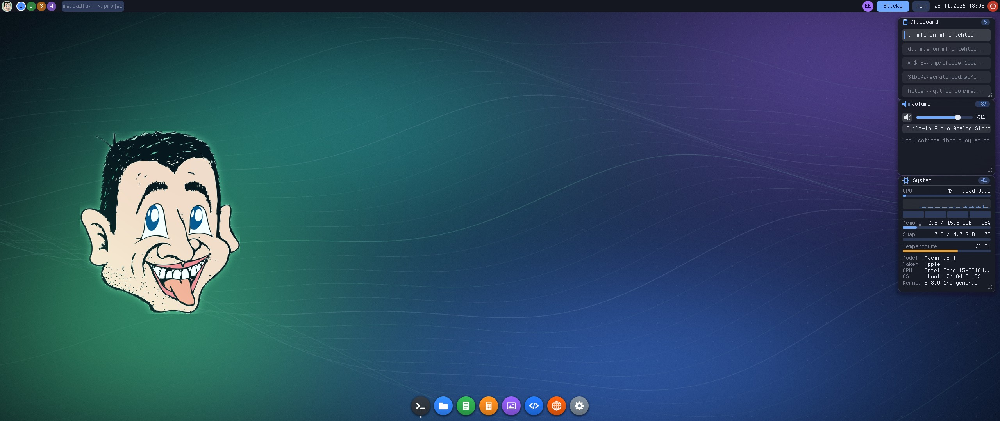

# MellaGUI

**MellaGUI** (*Mella's Graphical User Interface*) is a graphical environment for Linux that runs **without X11**: a from-scratch
Wayland compositor with a built-in shell (panel, four workspaces, window
frames, wallpaper), written in C11 with no dependencies besides libc and the
libdrm headers. It runs directly on a Linux virtual terminal using DRM/KMS and
evdev and composites in software (wl_shm clients only, no GL).

Included programs:

| binary            | what it is                                                       |
|-------------------|------------------------------------------------------------------|
| `build/mellagui`     | the compositor / shell                                            |
| `build/mellagui-term`| terminal emulator (xterm-compatible subset, 256/true colour, scrollback, mouse selection + clipboard; `mellagui-term -e CMD [ARGS...]` runs a program instead of the shell and closes when it ends, so `@terminal -e alpine` makes a dock / launcher entry for a text program); round button bar *Paste, A-, zoom list, A+, Reset* (buttons that do not fit a narrow window are left out): the font zooms 50-500 % in fine steps (the % button opens a list of sizes; Ctrl +/-, Ctrl+wheel, Ctrl+0 = reset) and the window grows or shrinks with it (the same columns and rows stay; a window that would not fit the screen is made to fit, a maximized one gets a new grid); the size is remembered in `~/.config/mellagui/terminal.conf` (`zoom=<percent>`, written by the terminal itself) and the next terminal starts with it |
| `build/mellagui-run` | "Run command" dialog (Super+R or the panel's *Run* button; Up/Down history) |
| `build/mellagui-settings` | settings panel (Super+I or *MellaGUI* → Settings): keyboard layouts, sticky keys, key repeat, pointer speed, double-click time (with a box to try it), natural scrolling, gadget, sound, resolution, sound outputs; `--get` / `--set KEY=VALUE` for scripts |
| `build/mellagui-files`| two-pane file manager in the spirit of Midnight / Norton Commander (dock *Files*, or `mellagui-files [DIR]`, default the home directory): two panes with their own folders (folders first, then files by name, sizes and times; pictures, programs and marked files have their own colours), Tab switches the active pane; Enter or Right opens (folder: goes in; png / jpg / ppm: `mellagui-view`; text: `mellagui-edit`; binary files are refused), Backspace / Left / Alt+Up goes up, Ctrl+H hidden files, Ctrl+R reread, Ctrl+T terminal here, Ctrl+L type a path, a letter jumps to the next name; **preview**: F3 / Ctrl+Q / the *Preview* button turn the inactive pane into a preview of the file under the cursor (text, hex dump of binary files, scaled pictures, the contents of a folder; Shift+Up / Down or the wheel scroll it); **file operations** on the marked files (Insert / Space marks) or else the one under the cursor: F2 rename, F5 copy and F6 move (to the other pane's folder, the question is editable and Tab completes names), F7 new folder, F8 / Delete move to the trash (`~/.local/share/Trash`, FreeDesktop layout with `.trashinfo`; Shift+F8 deletes for good, and inside the trash a delete is always for good; the *Trash* button / Ctrl+B opens it, where the status line tells where each file was deleted from and the *Restore* button / Ctrl+Z puts the marked files back there, making the folders on the way and never replacing anything; the *Empty* button / Ctrl+E deletes everything in the trash for good after asking), all asking first; copy, move and delete run in a background thread with a progress bar in the status line and Esc cancels; nothing that exists is ever replaced, links are copied as links; F1 lists the keys, F4 edits, F9 opens a terminal, F10 quits; round colourful buttons on top and the function key bar at the bottom; **network drives**: the *Network* button / Ctrl+N shows the servers (Windows / SMB shares, a router's USB disk, a NAS), Ctrl+K connects (`host`, `user@host`, `host legacy`), shares are folders and F2 / F5 / F6 / F7 / F8 work on them through `smbclient` (nothing is mounted, no root); SSH servers too: `sftp://user@host[:port]` in Ctrl+K opens the home folder through OpenSSH's `sftp` (keys and the agent, or a password that is handed to ssh only through its askpass mechanism); `--choose wallpaper [DIR]` is the one-pane picture chooser the Settings panel uses; `--selftest` |
| `build/mellagui-edit`| text editor (MellaGUI menu → Editor, or `mellagui-edit [FILE]`): UTF-8 text with line numbers, selection (keys and mouse, double click = word), clipboard (Ctrl+C/X/V), undo/redo (Ctrl+Z/Y; a run of typing is one step), a round colourful button bar (New, Open, Save, Save as, Find, A-, zoom, A+, Help) and F1 key list, the same 50-500 % text zoom as the terminal (Ctrl+= / Ctrl+- / Ctrl+0, Ctrl+wheel; the window grows with it; kept in `~/.config/mellagui/editor.conf`), Ctrl+S save / Ctrl+Shift+S save as / Ctrl+O open / Ctrl+N new (the Open / Save as prompts start in the file's folder, take `~/` and relative names, Tab completes names, Enter on a folder looks inside, Save as asks before replacing another file), Ctrl+F find (Enter / F3 next), Ctrl+G go to line, Ctrl+Q quit (asks once when there are unsaved changes, so does a close request from the compositor); keeps CRLF line ends and a missing final newline, refuses binary / non UTF-8 / >8 MB files; `--selftest` |
| `build/mellagui-view`| image viewer and video player (`.mp4`: the recordings of `mellagui-record` play by themselves, other H.264 and anything else through ffmpeg when it is installed; buttons in the bottom bar (back 5 s, play / pause, stop, on 5 s) or Space / Left / Right, a click on the bar seeks, no sound) (PNG, JPEG, PPM; MellaGUI menu → Images, or `mellagui-view [FILE|DIR]`): defaults to the newest screenshot in `~/Pictures`; Left/Right browse, +/- and the wheel zoom, drag pans, F fits, 0 is 100 %, R rescans, Esc quits; has its own inflate and JPEG decoder (baseline and progressive, EXIF orientation), `--decode FILE OUT.ppm` for tests |
| `build/mellagui-record` | screen recorder: Record / Stop, the output and the frame rate in a small window (Space, O, F, Esc), or `mellagui-record --start --duration 10 [--output N] [--fps N] [--dir DIR]` without clicking (Ctrl+C / SIGTERM finish the file); writes `~/Videos/mellagui-YYYYMMDD-HHMMSS.mp4` (`--dir`, `$MELLAGUI_RECORD_DIR`) as H.264 (`--codec auto|h264|ffmpeg|mjpeg`: x264 through ffmpeg when it is installed, else mellagui's own H.264 encoder; both play everywhere, browsers too; Motion JPEG is the big-file option); a still screen costs nothing (the pointer is in the picture), no sound. While it records its window goes away and the top bar shows a blinking red dot with the time (click it to stop). A key for it: `Super+F12 = exec mellagui-record --start` in `[keys]` |
| `build/mellagui-calendar` | the calendar of the panel's clock: the compositor starts it with itself, it waits hidden, a click on the clock shows it under the clock (time, date, a month with today marked, optional week numbers; arrows / wheel / PgUp / PgDn change the month, Up / Down the year, Home or T today, Esc hides it; it hides when something else is clicked). The settings panel's *Clock* page: 12 / 24 hour clock, seconds, date in the panel, weekday, date format (10.11.2026, 2026-11-10, 11/10/2026, 10 Nov 2026), calendar on / off, week starts on Monday / Sunday, week numbers; the lock screen's clock follows them. Another program: `[commands] calendar = ...` |
| `build/mellagui-top` | the process and service manager (Ctrl+Shift+Esc, or the dock's *Processes* button): **Processes** - every process from /proc once a second with CPU of one core, memory, state, nice value, user and command line, a header with the machine's CPU (history graph), memory, swap, load and uptime; click a column or C / M / P / N / O sorts, U shows only yours, / filters, Space stops the refresh; T / Delete ends the process (SIGTERM) and K / Shift+Delete kills it (both ask first), S pauses, R lets it go on, + / - change its nice value, a right click gives the same as a menu (it also copies the command or the PID); the system says when you may not signal a process. **Services** - the systemd services of the system or (U) the user session, failed ones first; S start, X stop (asks), R restart, E / D enable / disable, Enter shows the journal (`journalctl -u`); a system service needs the rights polkit gives and systemd's refusal is shown otherwise; `--list [N]` prints the busiest processes, `--selftest` |
| `build/mellagui-du` | what eats the disk (Ctrl+U in the file manager, or `mellagui-du [DIR]`): the folder tree is read once in a thread (links not followed, a file with several names counted once, only the disk of the folder unless X) and shown as a sorted list with bars and as a tree map; click or Enter goes into a folder, Backspace out, A switches disk usage / apparent size, F shows it in the file manager, C copies the path, Delete deletes after asking; `--list [--apparent] [DIR] [N]` prints the biggest things as text, `--selftest` |
| `build/mellagui-matrix`| the screensaver: falling green code in the manner of the film. The compositor starts it full screen after 10 minutes without input (settings panel → *Saver*: on / off, the minutes, *Show it now*; `[commands] saver = ...` names another program), any key, mouse button or pointer movement ends it and is not passed on; it does not start over a full screen window. `mellagui-matrix --windowed` runs it in an ordinary window (Esc quits), `--speed PERCENT`; `--selftest` |
| `build/mellagui-notify`| `mellagui-notify [-t MS] TITLE [BODY...]` shows a notification card (top right below the panel, newest on top, at most five; a click dismisses it, `-t 0` keeps it, default 6 s); like the settings panel it is served only to MellaGUI's own programs |
| `build/mellagui-calc`| calculator with round colourful keys (mouse or keyboard): left-to-right arithmetic with the sum so far shown above the result, `%`, +/-, square root / square / 1/x, memory (MC MR M+ M-, an "M" shows while something is stored), Ctrl+C copies the number on the display and Ctrl+V pastes the first number of the clipboard; `--selftest` checks the arithmetic engine, the sum line and the paste parser |

## Status (read this)

* Developed and **tested headless** (60+ end-to-end tests with a from-scratch Python wire client, ASan/UBSan clean).
  Rendering, the window manager, xdg-shell, input routing, clipboard, terminal and the other clients are exercised there.
* The **DRM/KMS + VT backend (`src/backend_drm.c`) has not been run on real hardware** by its author:
  it was written carefully against the kernel APIs and compiles warning-free, but expect to debug it on first use.
  Use `--timeout` for the first run (see below).
* **Renderer** (`--renderer software|auto|gl`; env `MELLAGUI_RENDERER`): on the display the default is `auto`: a hybrid OpenGL ES renderer (EGL / GLES2 / GBM are `dlopen()`ed, no headers needed) when it works, else the software compositor. The GPU composites the client surfaces, the panel, frames, text and lock screen stay the software painters and reach it as textures, GPU clients' dmabufs (Firefox, Mesa EGL) are sampled in place without a CPU copy, in whatever single-plane layout the GPU can read (linear, and tiled ones such as Intel X / Y tiled: the format table and the feedback list them, queried from EGL when the GL renderer is on; with software rendering only linear is offered) (the buffer stays with MellaGUI until the client's next commit; a screenshot is rendered by the GPU, too), and the picture is scanned out through GBM surfaces (`backend_drm.c`). Its output equals the software one (tests `TestGLParity`; the whole suite also runs with `MELLAGUI_RENDERER=gl`). GL scanout was confirmed on a monitor; zero-copy dmabuf has only run against test buffers. `--renderer software` gives the old path (dumb buffers, CPU copy of dmabufs). The headless backend defaults to software.
* **logind** (`--logind off|auto|on`, default `auto`): started from a text console login, MellaGUI asks systemd-logind for the GPU and the input
  devices (`TakeControl` / `TakeDevice`, its own small D-Bus client, no libsystemd), so no group is needed and logind does the VT switching and the
  console mode. Where there is no usable session (ssh, `su`, a service) or the system bus is missing it falls back to opening the device files, which
  needs the groups `video` and `input`. The DRM / evdev wiring is untested on real hardware (the D-Bus client is tested against a fake logind and was
  checked against the real one up to `TakeControl`); `--logind off` gives the old behaviour.
* Not tested against third-party Wayland clients (GTK, Qt, foot ...): none were available where it was built.
  Buffers are `wl_shm` or `zwp_linux_dmabuf_v1` (linear ARGB8888/XRGB8888 only). GPU-rendering clients (Mesa EGL, Firefox's
  WebRender) hand MellaGUI dmabufs; MellaGUI still composites in software and only *reads* them (mmap + `DMA_BUF_IOCTL_SYNC`, SSE4.1
  streaming loads), so the GPU does the clients' drawing and the CPU only copies the finished frames. Measured on an Intel HD 4000
  with Firefox and an animation-heavy page at 2048x864: Firefox 140 % -> 70 % of a core and ~3x the frame rate; MellaGUI's own
  compositing 21 % -> 18 % at that three times higher frame rate (SSE2 blits, occlusion: what an opaque window covers is not painted).
  Clients without a render node (`--no-dmabuf`) use `GSK_RENDERER=cairo`, `QT_QUICK_BACKEND=software`-like settings.
* Keyboard layout is US only. No XWayland, layer-shell, viewporter, xdg-output, IME or screen locker.

## Build

Requires gcc, make, pkg-config and the libdrm headers (`libdrm-dev`).

    make            # build/mellagui, build/mellagui-term, build/mellagui-calc
    make asan       # build/mellagui-asan with AddressSanitizer + UBSan
    make run        # build and start MellaGUI (real VT; see below). EXEC=<prog>, TIMEOUT=<s>, HEADLESS=1 are optional
    make test       # end-to-end tests (headless backend, Python 3)
    MELLAGUI_BIN=build/mellagui-asan tests/run.sh   # the same tests under the sanitizers

## Packages it uses at run time

MellaGUI links against nothing but libc, so it starts on a bare system - but several parts are only a front end for a
program of the distribution and stay empty, dimmed or silent without it. Package names are Debian / Ubuntu's (24.04).

| Part | Package(s) | Programs used | Without it |
|------|------------|---------------|------------|
| **Sound**: volume, mute, output / microphone choice (mixer gadget, quick settings, Sound page) | `pipewire-pulse` `wireplumber` (the sound server) + `pulseaudio-utils` | `pactl`; else `wpctl` (`wireplumber`); the mixer gadget also `amixer` (`alsa-utils`) | "No mixer found", the Sound page says what is missing |
| **Sounds**: start-up chime, dock click, key / screenshot feedback, alarm | `pulseaudio-utils`, or `alsa-utils` for a bare ALSA device | `paplay`, `aplay` | silent |
| Sound card profile (Sound page, "Output device") | `pipewire-bin` | `pw-cli` | the list is empty |
| Sound of videos in the viewer | `ffmpeg` + `pipewire-bin` / `pulseaudio-utils` / `alsa-utils` | `ffmpeg`, then `pw-cat`, else `paplay`, else `aplay` | the picture plays without sound |
| Sound in recordings and camera clips | `ffmpeg`, or `pulseaudio-utils` | `ffmpeg -f pulse`, else `parec` | no sound track |
| **Bluetooth**: panel button, devices window, quick settings switch | `bluez` (+ `libspa-0.2-bluetooth` for speakers and headsets under PipeWire) | `bluetoothctl` | no button, the switch is dimmed |
| **Network**: panel button, Wi-Fi list, quick settings switch | `network-manager` | `nmcli` | no button, the switch is dimmed |
| **Smooth text** (TrueType instead of the built-in 8x16 pixel font: a monospace font for terminals and tables, a proportional one for labels; `[font] file` / `ui` in mellagui.conf, or Settings > Themes > Font) | `fonts-dejavu-core` (DejaVu Sans Mono + DejaVu Sans), or any `.ttf` | read by MellaGUI's own rasteriser | the pixel font |
| Battery in the panel | - (reads `/sys/class/power_supply`) | | |
| **Graphics acceleration** (`--renderer auto` / `gl`) | `libegl1` `libgles2` `libgbm1` `libgl1-mesa-dri` | `dlopen()`ed | the software renderer is used |
| Devices without the `video` / `input` groups, VT switching, Suspend / Restart / Shutdown, the service list of the process manager | `systemd` (logind) + `dbus` | system bus, `systemctl`, `journalctl` | join the groups (see below); the power buttons report the failure |
| Videos other than MellaGUI's own recordings, best compression in the recorder | `ffmpeg` | `ffmpeg` | own H.264 / Motion JPEG only |
| Network drives in the file manager (`smb://`) | `smbclient` | `smbclient` | an error message when connecting |
| SSH servers in the file manager (`sftp://`) | `openssh-client` | `sftp` | an error message when connecting |
| Smart home (Smart Life / Tuya) | `curl` | `curl` | no login, no devices |
| Opening found files of unknown types (launcher search) | `xdg-utils` | `xdg-open` | nothing happens |
| Monitor settings (brightness, input ... over DDC/CI) | kernel module `i2c-dev`, access to `/dev/i2c-*` (group `i2c`) | | only a laptop's backlight |
| Camera | - (V4L2, `/dev/video*`, group `video`) | | |
| Tests | `python3`; some need `ffmpeg`, `curl`, `python3-cryptography`, `python3-pil` | | those tests are skipped |

Everything at once:

    sudo apt install pipewire-pulse wireplumber pipewire-bin pulseaudio-utils alsa-utils \
                     bluez libspa-0.2-bluetooth network-manager \
                     libegl1 libgles2 libgbm1 libgl1-mesa-dri \
                     ffmpeg smbclient openssh-client curl xdg-utils fonts-dejavu-core

The sound server must run in the user's session (`systemctl --user enable --now pipewire pipewire-pulse wireplumber`), and
`bluetooth` / `NetworkManager` as system services (`sudo systemctl enable --now bluetooth NetworkManager`).

## Run on a real console (first time)

1. One-time: give your user access to the GPU and input devices, then log out and in again:

       sudo usermod -aG video,input $USER

2. Switch to a free text console with **Ctrl+Alt+F3** and log in there (not over ssh, not from a terminal emulator;
   no X/Wayland session may be running on that VT).
3. Start it with a safety timeout so a mistake cannot trap you:

       cd /path/to/GUI
       build/mellagui --timeout 60 --terminal build/mellagui-term --exec build/mellagui-term --log-file ~/mellagui.log

   Without `--timeout` it runs until you quit (Super+Shift+E) or kill it.
   If no keyboard can be opened (missing `input` group) MellaGUI refuses to start instead of leaving a dead screen.

Leave with **Super+Shift+E**, or switch consoles with **Ctrl+Alt+F1..F12** (MellaGUI hands the display back
and takes it again when you return).

### If the screen is stuck

MellaGUI restores the text console on every normal exit and on SIGSEGV/SIGABRT. After a `kill -9` the console can stay
in graphics mode with the keyboard off. From another machine (ssh) or another VT that still works:

    pkill mellagui                # normal exit path restores everything
    sudo kbd_mode -u -C /dev/tty3 ; sudo chvt 1     # last resort (adjust tty number)

## Screen scale (HiDPI)

Settings > Display > Scale (100 - 300 %, or `--scale 1.5`) makes everything bigger: the panel, dock, window frames and every
program that supports it are drawn at the screen's own pixels, so they stay sharp (all MellaGUI programs do). Other programs (Firefox, ...) draw at the screen's scale themselves when they can, else the shell enlarges
them and they look softer. Screenshots and recordings have the screen's own pixels.

To try it on a real screen safely: from a free text console, `build/mellagui --timeout 60 --scale 2` (it ends by itself).

## Keys and mouse

The Super+... shortcuts below are the defaults. Change them in the `[keys]` section of `~/.config/mellagui/mellagui.conf`, e.g.
`Super+T = exec @terminal -e htop`, `Alt+F4 = close`, `Super+Q = none`; `mellagui --print-config` lists every action and binding.

| key                         | action                                  |
|-----------------------------|-----------------------------------------|
| Super+Enter                 | open terminal (`--terminal` command)    |
| Super+R                     | run dialog (`--run` command)            |
| Super+Q                     | close focused window                    |
| Alt+Tab / Alt+Shift+Tab     | window list in use order (all workspaces): hold Alt, Tab steps, releasing Alt goes there, Esc stays |
| Super+1..4 / +Shift         | switch workspace / move window there    |
| Super+Tab (+Shift)          | cycle windows (minimized ones included) |
| Super+M / Super+F           | maximize / fullscreen toggle            |
| Super+Left / Super+Right    | tile window to the left / right half    |
| Super+Up / Super+Down       | maximize / restore (un-maximize or un-tile) |
| Super+Space (+Shift)        | next / previous keyboard layout         |
| Super+L                     | lock the screen (needs a password / PIN, see below) |
| Print / Alt+Print           | screenshot of the screen under the pointer / of the focused window (with its frame), no cursor: PNG in `~/Pictures` (`--screenshot-dir`) **and** on the clipboard as `image/png` |
| Ctrl+Print                  | the same screenshot of the screen, clipboard only (feedback for all three: a short white flash and, for 8 s, a thumbnail card with the file name in the bottom right corner; a click on the card opens the file in the viewer; never part of a screenshot) |
| Super+Shift+E               | quit MellaGUI                              |
| Ctrl+Alt+F1..F12            | switch virtual console                  |

Panel: *MellaGUI* (app menu: Terminal, Calculator, Images, Editor, Files, if found (`~/VSCode/code` or the snap's binary) Code, if found (`/snap/bin/firefox` or `/usr/bin/firefox`; started with native Wayland and GPU rendering) Firefox, and Settings; Esc or an outside click closes it;
change it in `~/.config/mellagui/mellagui.conf` (`[menu]`, `Name = command`; `mellagui --print-config` shows the defaults) or add entries with `--app "Name=command"`, repeatable; colours: `[theme]`, shortcuts: `[keys]`, sizes of panel / frames / menu / gadgets: `[panel]`, `[windows]`, `[gadgets]` in the same file; **Super+Shift+R**, `kill -USR2` or the control socket's `reload` read it again without a restart; the settings panel's *Config* page creates, opens and reloads the file, its *Menu* page edits the app menu and its *Keys* page the shortcuts (press the keys to record them), its *Colours* page the palette (hex field and sliders), its *Sizes* page the sizes of panel, frames, menu and gadgets: add, change, remove, restore defaults), workspace cells, taskbar, then on the right the layout indicator, *Sticky*, and *Run* (run dialog), the clock and, in the top right corner, the round
*power button*: it opens the session dialog (the screen is dimmed, a card with two round buttons, *Lock* and *Exit*; click a button, or Left / Right / Tab then Enter, or press L / E; Esc, a click outside the card or the
power button again closes it; the dialog is modal, nothing below it gets keys or clicks).

### Screen lock

*Settings* → *Security* sets a password (8+ characters) or a PIN (4-12 digits), an idle time after which the screen locks by itself
(0 = never), how long after locking the monitors go to standby ("Screen off after", default 3 minutes, 0 = never) and "Lock when MellaGUI starts". **Super+L**, *Lock* in the panel's session dialog or the page's *Lock now* lock the screen; with no
password set yet the button opens the settings instead. Type the secret and press Enter (Esc clears, Backspace deletes; Super+Space
switches the keyboard layout, Ctrl+Alt+F1..F12 still switches the console).

* The lock is part of the compositor: while it is on nothing of the session is drawn, no key or mouse event reaches any program and
  no shortcut works (Super+Shift+E included).
* Only a salted PBKDF2-HMAC-SHA256 hash (200000 rounds) is stored, in `~/.config/mellagui/lock.conf` (mode 0600; `--lock-file`).
  Changing or removing the lock needs the current secret. Three wrong tries in a row start a delay that doubles from 5 s up to 5 minutes.
* Standby: with the screen locked and no input for that long, the monitors are switched off (DRM DPMS, they lose the signal and sleep).
  The first key press or mouse move only wakes them; unlocking wakes them too. Not tested on real hardware yet.
* With a lock set, Super+Shift+E and *Exit* in the session dialog lock the screen and quit only after the secret was typed (Esc on an empty
  field cancels). *Lock when MellaGUI starts* is on by default, and "Console switch works while locked" can be turned off.
  For a server run MellaGUI as a service so there is no shell behind it: see [docs/SERVER.md](docs/SERVER.md) and `contrib/mellagui.service`.
* Who may connect: the Wayland socket is 0600 and the compositor refuses clients of other users. On a real display only MellaGUI's own
  programs may use the settings interface (`--settings-access any` opens it to every client).
* A forgotten secret cannot be reset from inside the session: log in another way (ssh, another console), delete `lock.conf` and restart MellaGUI.
* What it does not do: it does not protect against someone who can log in as you on another console or over ssh, and a program running as
  your user can read `lock.conf` and guess a short PIN offline. It is a screen lock against someone at the keyboard.

Keyboard layouts and sticky keys: `--layouts us,ee,de,fi` (the default; up to four, the first is active at start; also `us,ee`
etc.) selects what you can switch between with Super+Space, or with the panel indicator (left click next, right click previous).
Layouts: `us`, `ee` (Estonian: ü õ ö ä, AltGr+f = š, AltGr+z = ž), `de`, `fi`; no dead keys. With anything but a lone `us`
the right Alt key is AltGr (third/fourth level, `AltGr+e` = €). `--sticky` (or the panel's *Sticky* button, or pressing Shift five
times in a row) turns on sticky keys: tapping Shift/Ctrl/Alt/AltGr/Super applies it to the next key press only, tapping it twice
locks it, a third tap unlocks. The button shows the latched (`Sh`) or locked (`SH`) modifiers. Each change beeps (latch, lock, unlock, sticky on/off; the tones are
synthesised and piped to `aplay`, so it needs alsa-utils and a sound card; `--no-sound` silences it).

Settings panel: Super+I or *MellaGUI* → *Settings* opens `mellagui-settings` (Tab / Shift+Tab, Enter or Space, Left/Right on sliders, Esc).
*Keyboard* enables and orders the layouts (the checkbox, the `^` button; *active* picks the current one - the clients get a new keymap at
once, nothing has to be restarted), sticky keys, key repeat delay and rate, and has a field for trying the layout. *Pointer*: speed and
natural scrolling. *Desktop*: the clipboard gadget and the sound feedback, and the **wallpaper**: a PNG, JPEG or PPM file (type its path, `~/` is your home; Enter or *Apply*, or *Browse...*, which opens the file browser as a picture chooser in `~/Pictures`: Enter or a double click on a picture sets it, Esc cancels) placed *Fill* (covers the screen, cropped), *Fit* (whole picture, bars), *Stretch* or *Center* (unscaled); *No picture* goes back to the gradient; a file that cannot be read is reported below the field (`wallpaper`, `wallpaper-mode` in `mellagui-settings --set`). *Display*: with two or more monitors first their order, left to right (`<` / `>` per monitor; saved as `output-order`, windows move with their monitor, the gadgets and notifications live on the leftmost), then the resolution (automatic, the monitor's preferred
mode, or one of its modes - the list includes a mode in the panel's own shape when the GPU does not offer the native one, and the panel's native size at the highest usual refresh rate (60, 59, 50, 48 ... Hz) whose pixel clock the link already takes, e.g. 2560x1080 at 50 Hz where 60 Hz needs a faster clock than the GPU's HDMI output allows); it is applied at
once and goes back after 15 s unless you press *Keep* (a wrong mode can leave the screen black, and a black screen cannot confirm anything);
only a kept resolution is saved. *Sound*: the sound card's **output device** (analog, HDMI, S/PDIF: with PipeWire this is the card profile, switched with `pw-cli`; this is
how HDMI audio is chosen, the new output becomes the default one within a second or two), the default output for applications such as
Firefox when a PulseAudio/PipeWire server runs, and the ALSA device for MellaGUI's own beeps (HDMI/DisplayPort outputs are listed and marked) (`pactl`, else PipeWire's `wpctl`). When nothing is
listed the page says why: neither tool installed (`sudo apt install pulseaudio-utils`), or no sound server answering (start it with
`systemctl --user enable --now pipewire pipewire-pulse wireplumber`; it can take a few seconds until the devices appear). Changes apply immediately and are saved (about 0.3 s later) to
`$XDG_CONFIG_HOME/mellagui/settings.conf` (`~/.config/mellagui/settings.conf`; `--settings FILE` chooses another file, `--settings none` saves
nothing; headless runs save nothing unless `--settings` is given). The file is plain `key=value` and is read at start; options such as
`--layouts` or `--sticky` on the command line win over it. From a script: `mellagui-settings --set layouts=ee,us repeat-rate=30`,
`mellagui-settings --get`. Anyone on the user's Wayland socket can change the settings (the `mellagui_settings_v1` protocol has no authentication).

Desktop gadgets: each gadget is a small program of its own (`mellagui-gadget clipboard|mixer|system|smart`) that the compositor starts when
the gadget is switched on and ends when it is switched off - a rounded card in a frameless window above the wallpaper and below all
windows, on every workspace, docked at the top right until you move it. The first one shows the clipboard history: the last fifty
distinct texts that applications copied, newest first (up to 2 KiB read per copy; images and files are ignored; the compositor reads
them itself, so it also sees what was copied while no window had focus). Click an entry to use it again, the x forgets it, the arrows
page, the trash can forgets all; Super+C gives the card the keyboard (arrows, Enter, Delete, Esc). Drag the title bar to move it (it
stays on the output, below the panel, and sticks to the screen's and the other cards' edges); drag an edge or corner (the dotted grip
bottom right) to resize it, 180x70 up to 640x1600: a taller card shows more entries. Double-click the title bar to get the default
size and place back; a card you moved or resized stays there the next time (`windows.conf`). Super+G shows/hides it, `--no-gadget`
starts it hidden.

Volume mixer gadget: a second card of the same kind (Super+V, `--mixer`, or *Desktop* → *Volume mixer gadget* in the settings panel; hidden
by default). It docks below the clipboard card (beside it on a small screen) and is moved/resized the same way. Inside: the master
volume slider with a mute button, and - with a PulseAudio/PipeWire pulse server and `pactl` (package `pulseaudio-utils`) - the output
(click it to switch to the next one, e.g. HDMI) and one slider with a mute button per playing application. Without `pactl` it uses
PipeWire's `wpctl` (master volume and mute of the default output), and without that ALSA's `Master` control through `amixer`. The state is
read every 3 s while the card is visible and after each change; the programs run as short child processes started by the event loop, so a
slow one never stalls the compositor, and slider drags are coalesced (one command at a time).

System monitor gadget: a third card (Super+S, `--sysinfo`, or *Desktop* → *System monitor gadget*; hidden by default) with the CPU load (a
bar, a one-minute graph and one small bar per logical CPU), memory and swap use, and the CPU temperature (the package sensor of
`coretemp`/`k10temp`, else a CPU thermal zone; bar green / amber from 70 / red from 85 degrees) - plain reads of `/proc/stat`,
`/proc/meminfo`, `/sys/class/hwmon` and `/sys/class/thermal` once a second while it is visible. Rows that do not fit the card's height
are left out (CPU, memory and temperature always stay). The three cards dock under each other at the top right, in a column to the left
when the screen is too low, and cascade when even that does not fit.

Mouse: drag the title bar to move, drag the border/corners to resize, double-click the title bar to maximize,
buttons for minimize/maximize/close, click the panel's workspace cells or the *MellaGUI* launcher.
The panel's taskbar lists the windows of the current workspace: click a button to focus it (or restore it if minimized),
click the focused one to minimize it, middle-click to close. Dragging a tiled window restores its previous size.

In `mellagui-run`: type a shell command, Enter starts it detached (no window of its own is left behind), Esc cancels,
Up/Down browse the history (`~/.cache/mellagui-run-history`), Ctrl+U clears the line.

In `mellagui-calc`: digits, `.`, `+ - * /`, `%`, Enter or `=` to evaluate, Backspace to erase, Esc or `c` to clear; `r` square root, `q` square, `i` 1/x, `n` +/-; memory `p` M+, `o` M-, `m` MR, `z` MC; Ctrl+C / Ctrl+V copy and paste a number
(operators are applied left to right).

In `mellagui-term`: select with the mouse (auto-copies), middle-click or Ctrl+Shift+V / Shift+Insert paste,
Ctrl+Shift+C copy, Shift+PageUp/PageDown scrollback, mouse wheel scrolls.

## Options

    build/mellagui --help

Notable: `--backend drm|headless`, `--exec CMD`, `--terminal CMD`, `--run CMD`, `--app NAME=CMD`, `--socket NAME`, `--drm-device /dev/dri/cardN`, `--mode WxH[@Hz]`,
`--log-level debug`, `--log-file PATH`, `--no-grab`, `--timeout SECONDS`.
Clients find the compositor through `WAYLAND_DISPLAY` (set automatically for `--exec` and the launcher).

## Headless mode and tests

    build/mellagui --backend headless --size 1280x720 --control /tmp/mellagui.ctl --socket demo

The control socket takes one line per command (`dump <file.ppm>`, `windows`, `key <code> <0|1>`, `abs <x> <y>`,
`button <code> <0|1>`, `axis`, `sync`, `quit`; see `src/backend.h`). `tools/ppm2png.py` converts dumps to PNG.
`tests/wlclient.py` is a dependency-free Wayland client library in Python.

## Troubleshooting

* `no permission to open /dev/dri/card*` / `/dev/input/event*` – logind was not used (the log says why: `logind not used: ...`); join the groups `video` / `input` and log in again, or start MellaGUI from a console login that logind knows (`loginctl` shows the session with a seat).
* `logind is required ... (--logind on)` – no usable session; see the reason after it. `--logind off` skips logind.
* `cannot become DRM master` – another display server owns the GPU on this VT (or you are on the wrong VT).
* `/dev/tty is not a Linux virtual console` – start MellaGUI from a text console (Ctrl+Alt+F3), not from ssh or a terminal emulator.
* Black screen – read the log file (`--log-file`), try `--drm-device /dev/dri/card0`.
* Picture stretched (circles look like ovals) – the monitor's panel has another shape than the video mode (e.g. a 21:9 panel driven
  with 16:9 2048x1152: the GPU's HDMI pixel clock limit cut the panel's own mode away). MellaGUI corrects this by itself: when the
  preferred mode's shape differs from the monitor's native timing (the first detailed timing in its EDID) by more than 8 %, and the
  physical size in the EDID does not contradict that (broken EDIDs of projectors and TVs are left alone), it generates a mode of the
  same width and the native shape (CVT reduced blanking, e.g. 2048x864) and logs it; if the kernel refuses it, the preferred mode is
  used. `--mode WxH[@Hz]` forces a size, `--mode preferred` turns the correction off; the Display page of the settings panel changes it
  while running.
* Graphics-accelerated apps show nothing – they need `linux-dmabuf` (offered when a render node `/dev/dri/renderD*` exists; `--no-dmabuf` turns it off) or a software renderer; see Status.

Architecture notes for developers: [docs/ARCHITECTURE.md](docs/ARCHITECTURE.md) and [CLAUDE.md](CLAUDE.md).
